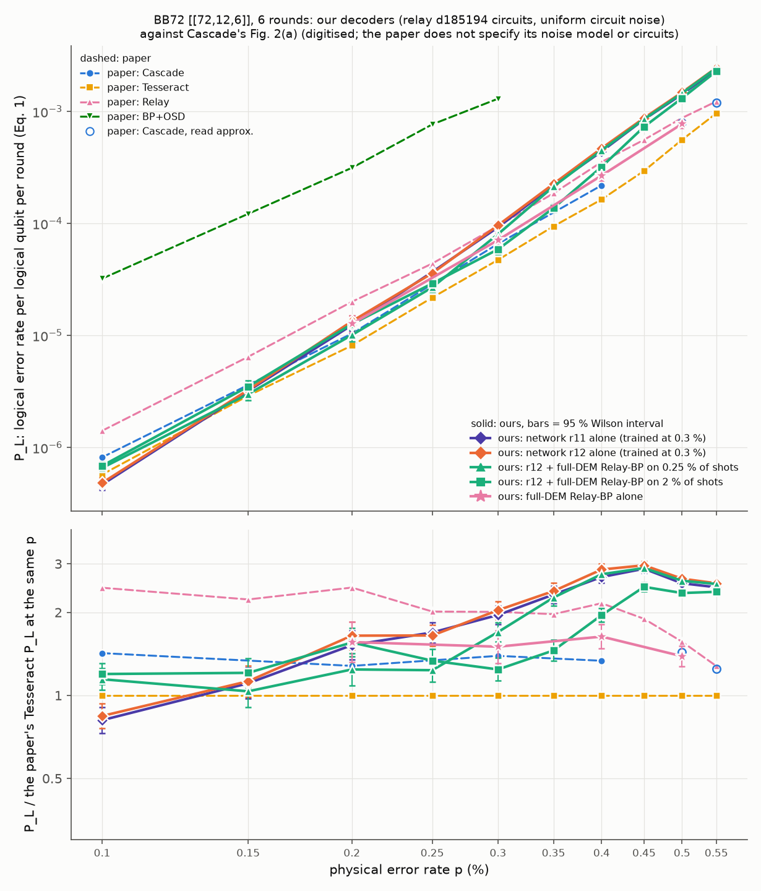

# BB72 across the p range of Cascade's Fig. 2(a), in Cascade's metric

2026-10-08. Exploratory comparison with Cascade (Gu, Bonilla Ataides, Lukin and Yelin, arXiv:2604.08358),
not a registered study: no freeze and no claim registered in advance. Hub branch `ising-cascade-curves`, created from
`ising-bb-gross2` at c5aa1fcf. Code: `bb/cascade/curves.py` with its job scripts (`bb/cascade/cpu.sbatch`,
`bb/cascade/gpu.sbatch`, `bb/cascade/args/*.txt`). Raw counts: `bb/cascade/curves_counts.json`. Plot:
`bb/cascade/curves.png`. Records: `data/bb/cascade/` (shot manifest, taus, pilot, circuit check). All shots are fresh,
drawn from the curve sets' own seeds; no registered split (cal, dev, test, monitor) was read.

## In short

In Cascade's metric (logical errors per logical qubit per round), our networks alone beat Cascade at p = 0.1 %: r12
gives 4.8e-7 against Cascade's 8.2e-7 (0.59x) and Tesseract's 5.7e-7 (0.84x). Near 0.15 % they are about level with
Tesseract (1.11-1.13x); Cascade has no point there. From 0.2 % up they fall behind: 1.2-1.3x Cascade at 0.2 %,
1.4-1.5x at 0.3 % and 2.0-2.1x at 0.4 %; against Tesseract the gap grows from 1.5-1.7x at 0.2-0.25 % to 2-3x between
0.3 % and 0.55 %. Our curves rise more steeply with p than the paper's. Between 0.1 % and 0.4 % our network's error
rate grows about 970-fold, Cascade's about 270-fold.

The accurate mode, where r12 hands its least confident shots to full-DEM Relay-BP, helps from 0.2 % up. It reaches
1.0e-5 at 0.2 % (routing q = 0.25 % of shots; 0.97x Cascade, 1.24x Tesseract), 5.9e-5 at 0.3 % (q = 2 %; 0.89x
Cascade, 1.24x Tesseract) and 3.2e-4 at 0.4 % (q = 2 %; 1.46x Cascade, 1.95x Tesseract). At 0.1 % it makes things
worse (6.6-6.9e-7 instead of 4.8e-7): there, full-DEM Relay-BP fails on more of the routed shots than the network does
(469 against 344 of the 28,991 shots routed at q = 0.25 %).

The paper does not specify its noise model or its syndrome-extraction circuits, and two of its reference decoders do
better on our circuits than in the paper: our full-DEM Relay-BP comes out at 0.63-0.89x the paper's Relay curve, and
the paper's BP+OSD configuration, run on our circuits, at 0.19x the paper's BP+OSD point at 0.3 % (our sector
Relay-BP, by contrast, is 1.9-2x the paper's Relay). Read the ratios below as indicative, since the two settings may
differ.

## Terms

| term | what it means |
|---|---|
| shot | one simulated run of the 6-round memory experiment: the detector bits a decoder reads, plus the true flips of the 12 logical observables |
| block failure, P_block | a shot fails if the decoder gets any of the 12 logical observables wrong; P_block = failures / shots |
| P_L (Eq. 1) | the paper's metric, logical errors per logical qubit per round: P_L = (1 - (2 (1 - P_block)^(1/k) - 1)^(1/R)) / 2 with k = 12 logical qubits and R = 6 rounds; for small rates P_L is about P_block / 72 |
| 95 % interval | the Wilson score interval on P_block (z = 1.96), converted to P_L by Eq. (1); it covers our sampling noise only, not the digitising error of the paper's values |
| r11, r12 | our two registered BB72 networks (ConvLines-BB), both trained at p = 0.3 % and used unchanged at every p here; "alone" = the top-1 class of their 4,096 class scores, as in the registered cells BB72-3 and BB72-2 |
| margin | r12's top-1 minus top-2 class score; a small margin means the network is unsure |
| q, tau | routing fraction and threshold: tau is the q-quantile of r12's margins on a separate calibration block of 100,000 shots at the same p, so about a fraction q of shots has margin < tau |
| accurate mode | r12 decides each shot unless its margin is below tau; those shots go to full-DEM Relay-BP, whose answer is used instead (BB72-2F used q = 0.25 %, BB72-3F q = 2 %) |
| full-DEM Relay-BP | IBM's Relay-BP (relay-bp 0.2.2) on the detector error model with both detector types (X and Z checks), with our frozen BB72 settings: pre-iterations 80, 300 sets of 60 iterations, stop after 5 solutions, gamma0 0.15, memory strengths drawn from [-0.226, 0.622] |
| sector Relay-BP | the same decoder on the X-check detectors only (registered opponent, shown for context) |

## Results

### Summary: P_L per logical qubit per round

Paper columns are the study lead's digitisation of Fig. 2(a). "~" marks Cascade values read only approximately,
where the curves overlap. Our columns come from the counts in the next table.

| p (%) | Cascade | Tesseract | Relay (paper) | r11 alone | r12 alone | r12 + Relay-BP q 0.25 % | r12 + Relay-BP q 2 % | our full-DEM Relay-BP | what it means |
|---|---|---|---|---|---|---|---|---|---|
| 0.1 | 8.17e-07 | 5.74e-07 | 1.41e-06 | 4.67e-07 | 4.83e-07 | 6.57e-07 | 6.86e-07 | - | r12 alone 0.59x Cascade, 0.84x Tesseract; accurate mode at 2 % 0.84x Cascade, 1.20x Tesseract |
| 0.15 | - | 2.90e-06 | 6.46e-06 | 3.21e-06 | 3.26e-06 | 3.00e-06 | 3.50e-06 | - | r12 alone 1.13x Tesseract; accurate mode at 2 % 1.21x Tesseract |
| 0.2 | 1.04e-05 | 8.13e-06 | 2.00e-05 | 1.24e-05 | 1.34e-05 | 1.01e-05 | 1.26e-05 | 1.27e-05 | r12 alone 1.29x Cascade, 1.65x Tesseract; accurate mode at 2 % 1.22x Cascade, 1.56x Tesseract |
| 0.25 | - | 2.18e-05 | 4.39e-05 | 3.69e-05 | 3.60e-05 | 2.69e-05 | 2.91e-05 | - | r12 alone 1.65x Tesseract; accurate mode at 2 % 1.34x Tesseract |
| 0.3 | 6.58e-05 | 4.73e-05 | 9.50e-05 | 9.25e-05 | 9.63e-05 | 8.02e-05 | 5.87e-05 | 7.10e-05 | r12 alone 1.46x Cascade, 2.04x Tesseract; accurate mode at 2 % 0.89x Cascade, 1.24x Tesseract |
| 0.35 | - | 9.44e-05 | 1.86e-04 | 2.19e-04 | 2.26e-04 | 2.14e-04 | 1.37e-04 | - | r12 alone 2.39x Tesseract; accurate mode at 2 % 1.46x Tesseract |
| 0.4 | 2.19e-04 | 1.64e-04 | 3.54e-04 | 4.41e-04 | 4.69e-04 | 4.51e-04 | 3.21e-04 | 2.68e-04 | r12 alone 2.14x Cascade, 2.86x Tesseract; accurate mode at 2 % 1.46x Cascade, 1.95x Tesseract |
| 0.45 | - | 2.95e-04 | 5.59e-04 | 8.49e-04 | 8.74e-04 | 8.54e-04 | 7.30e-04 | - | r12 alone 2.96x Tesseract; accurate mode at 2 % 2.48x Tesseract |
| 0.5 | ~8.00e-04 | 5.59e-04 | 8.75e-04 | 1.43e-03 | 1.48e-03 | 1.46e-03 | 1.31e-03 | 7.75e-04 | r12 alone 2.65x Tesseract; accurate mode at 2 % 2.35x Tesseract |
| 0.55 | ~1.20e-03 | 9.63e-04 | 1.23e-03 | 2.38e-03 | 2.46e-03 | 2.44e-03 | 2.29e-03 | - | r12 alone 2.55x Tesseract; accurate mode at 2 % 2.37x Tesseract |

### Every point: shots, failures, intervals and ratios

"routed (tau)" is the number of test shots the accurate mode sends to Relay-BP and the threshold used. "/ Cascade",
"/ Tesseract" and "/ Relay (paper)" divide our P_L by the paper's value at the same p: below 1 means fewer logical
errors than the paper's decoder. Full-DEM Relay-BP alone ran on the first 15 / 4 / 2 / 1 test chunks at 0.2 / 0.3 /
0.4 / 0.5 %, so its intervals are wider than the networks'.

| p (%) | decoder | shots | failures | P_block | P_block 95 % | P_L (Eq. 1) | P_L 95 % | routed (tau) | / Cascade | / Tesseract | / Relay (paper) |
|---|---|---|---|---|---|---|---|---|---|---|---|
| 0.1 | r11 alone | 10,000,000 | 336 | 3.36e-05 | 3.02e-05 - 3.74e-05 | 4.67e-07 | 4.19e-07 - 5.19e-07 | - | 0.57 | 0.81 | 0.33 |
| 0.1 | r12 alone | 10,000,000 | 348 | 3.48e-05 | 3.13e-05 - 3.87e-05 | 4.83e-07 | 4.35e-07 - 5.37e-07 | - | 0.59 | 0.84 | 0.34 |
| 0.1 | r12 + Relay-BP, q 0.25 % | 10,000,000 | 473 | 4.73e-05 | 4.32e-05 - 5.18e-05 | 6.57e-07 | 6.00e-07 - 7.19e-07 | 28,991 (10.2625) | 0.80 | 1.14 | 0.47 |
| 0.1 | r12 + Relay-BP, q 2 % | 10,000,000 | 494 | 4.94e-05 | 4.52e-05 - 5.40e-05 | 6.86e-07 | 6.28e-07 - 7.49e-07 | 205,155 (13.1089) | 0.84 | 1.20 | 0.49 |
| 0.15 | r11 alone | 1,000,000 | 231 | 2.31e-04 | 2.03e-04 - 2.63e-04 | 3.21e-06 | 2.82e-06 - 3.65e-06 | - | - | 1.11 | 0.50 |
| 0.15 | r12 alone | 1,000,000 | 235 | 2.35e-04 | 2.07e-04 - 2.67e-04 | 3.26e-06 | 2.87e-06 - 3.71e-06 | - | - | 1.13 | 0.51 |
| 0.15 | r12 + Relay-BP, q 0.25 % | 1,000,000 | 216 | 2.16e-04 | 1.89e-04 - 2.47e-04 | 3.00e-06 | 2.63e-06 - 3.43e-06 | 2,375 (5.6443) | - | 1.03 | 0.46 |
| 0.15 | r12 + Relay-BP, q 2 % | 1,000,000 | 252 | 2.52e-04 | 2.23e-04 - 2.85e-04 | 3.50e-06 | 3.09e-06 - 3.96e-06 | 20,473 (11.1430) | - | 1.21 | 0.54 |
| 0.2 | r11 alone | 300,000 | 267 | 8.90e-04 | 7.89e-04 - 1.00e-03 | 1.24e-05 | 1.10e-05 - 1.39e-05 | - | 1.19 | 1.52 | 0.62 |
| 0.2 | r12 alone | 300,000 | 289 | 9.63e-04 | 8.59e-04 - 1.08e-03 | 1.34e-05 | 1.19e-05 - 1.50e-05 | - | 1.29 | 1.65 | 0.67 |
| 0.2 | r12 + Relay-BP, q 0.25 % | 300,000 | 218 | 7.27e-04 | 6.36e-04 - 8.30e-04 | 1.01e-05 | 8.84e-06 - 1.15e-05 | 788 (2.9848) | 0.97 | 1.24 | 0.50 |
| 0.2 | r12 + Relay-BP, q 2 % | 300,000 | 273 | 9.10e-04 | 8.08e-04 - 1.02e-03 | 1.26e-05 | 1.12e-05 - 1.42e-05 | 6,100 (8.4944) | 1.22 | 1.56 | 0.63 |
| 0.2 | full-DEM Relay-BP alone | 150,000 | 137 | 9.13e-04 | 7.73e-04 - 1.08e-03 | 1.27e-05 | 1.07e-05 - 1.50e-05 | - | 1.22 | 1.56 | 0.63 |
| 0.25 | r11 alone | 200,000 | 530 | 2.65e-03 | 2.43e-03 - 2.89e-03 | 3.69e-05 | 3.38e-05 - 4.01e-05 | - | - | 1.69 | 0.84 |
| 0.25 | r12 alone | 200,000 | 517 | 2.59e-03 | 2.37e-03 - 2.82e-03 | 3.60e-05 | 3.30e-05 - 3.92e-05 | - | - | 1.65 | 0.82 |
| 0.25 | r12 + Relay-BP, q 0.25 % | 200,000 | 387 | 1.94e-03 | 1.75e-03 - 2.14e-03 | 2.69e-05 | 2.44e-05 - 2.97e-05 | 569 (1.2237) | - | 1.23 | 0.61 |
| 0.25 | r12 + Relay-BP, q 2 % | 200,000 | 419 | 2.10e-03 | 1.90e-03 - 2.31e-03 | 2.91e-05 | 2.65e-05 - 3.21e-05 | 4,140 (5.9888) | - | 1.34 | 0.66 |
| 0.3 | r11 alone | 100,000 | 664 | 6.64e-03 | 6.16e-03 - 7.16e-03 | 9.25e-05 | 8.58e-05 - 9.99e-05 | - | 1.41 | 1.96 | 0.97 |
| 0.3 | r12 alone | 100,000 | 691 | 6.91e-03 | 6.42e-03 - 7.44e-03 | 9.63e-05 | 8.94e-05 - 1.04e-04 | - | 1.46 | 2.04 | 1.01 |
| 0.3 | r12 + Relay-BP, q 0.25 % | 100,000 | 576 | 5.76e-03 | 5.31e-03 - 6.25e-03 | 8.02e-05 | 7.40e-05 - 8.71e-05 | 247 (0.3493) | 1.22 | 1.70 | 0.84 |
| 0.3 | r12 + Relay-BP, q 2 % | 100,000 | 422 | 4.22e-03 | 3.84e-03 - 4.64e-03 | 5.87e-05 | 5.34e-05 - 6.46e-05 | 1,980 (3.6341) | 0.89 | 1.24 | 0.62 |
| 0.3 | full-DEM Relay-BP alone | 40,000 | 204 | 5.10e-03 | 4.45e-03 - 5.85e-03 | 7.10e-05 | 6.19e-05 - 8.15e-05 | - | 1.08 | 1.50 | 0.75 |
| 0.35 | r11 alone | 50,000 | 782 | 1.56e-02 | 1.46e-02 - 1.68e-02 | 2.19e-04 | 2.04e-04 - 2.35e-04 | - | - | 2.32 | 1.18 |
| 0.35 | r12 alone | 50,000 | 805 | 1.61e-02 | 1.50e-02 - 1.72e-02 | 2.26e-04 | 2.10e-04 - 2.42e-04 | - | - | 2.39 | 1.21 |
| 0.35 | r12 + Relay-BP, q 0.25 % | 50,000 | 763 | 1.53e-02 | 1.42e-02 - 1.64e-02 | 2.14e-04 | 1.99e-04 - 2.29e-04 | 112 (0.1338) | - | 2.26 | 1.15 |
| 0.35 | r12 + Relay-BP, q 2 % | 50,000 | 492 | 9.84e-03 | 9.01e-03 - 1.07e-02 | 1.37e-04 | 1.26e-04 - 1.50e-04 | 984 (1.7202) | - | 1.46 | 0.74 |
| 0.4 | r11 alone | 50,000 | 1,560 | 3.12e-02 | 2.97e-02 - 3.28e-02 | 4.41e-04 | 4.19e-04 - 4.63e-04 | - | 2.01 | 2.69 | 1.24 |
| 0.4 | r12 alone | 50,000 | 1,659 | 3.32e-02 | 3.16e-02 - 3.48e-02 | 4.69e-04 | 4.47e-04 - 4.92e-04 | - | 2.14 | 2.86 | 1.33 |
| 0.4 | r12 + Relay-BP, q 0.25 % | 50,000 | 1,596 | 3.19e-02 | 3.04e-02 - 3.35e-02 | 4.51e-04 | 4.29e-04 - 4.74e-04 | 122 (0.0581) | 2.06 | 2.75 | 1.27 |
| 0.4 | r12 + Relay-BP, q 2 % | 50,000 | 1,140 | 2.28e-02 | 2.15e-02 - 2.41e-02 | 3.21e-04 | 3.02e-04 - 3.40e-04 | 1,010 (0.6604) | 1.46 | 1.95 | 0.91 |
| 0.4 | full-DEM Relay-BP alone | 20,000 | 382 | 1.91e-02 | 1.73e-02 - 2.11e-02 | 2.68e-04 | 2.42e-04 - 2.96e-04 | - | 1.22 | 1.63 | 0.76 |
| 0.45 | r11 alone | 50,000 | 2,961 | 5.92e-02 | 5.72e-02 - 6.13e-02 | 8.49e-04 | 8.19e-04 - 8.80e-04 | - | - | 2.88 | 1.52 |
| 0.45 | r12 alone | 50,000 | 3,044 | 6.09e-02 | 5.88e-02 - 6.30e-02 | 8.74e-04 | 8.43e-04 - 9.06e-04 | - | - | 2.96 | 1.56 |
| 0.45 | r12 + Relay-BP, q 0.25 % | 50,000 | 2,977 | 5.95e-02 | 5.75e-02 - 6.16e-02 | 8.54e-04 | 8.24e-04 - 8.85e-04 | 119 (0.0277) | - | 2.90 | 1.53 |
| 0.45 | r12 + Relay-BP, q 2 % | 50,000 | 2,557 | 5.11e-02 | 4.92e-02 - 5.31e-02 | 7.30e-04 | 7.02e-04 - 7.59e-04 | 983 (0.2793) | - | 2.48 | 1.31 |
| 0.5 | r11 alone | 50,000 | 4,864 | 9.73e-02 | 9.47e-02 - 9.99e-02 | 1.43e-03 | 1.39e-03 - 1.47e-03 | - | - | 2.55 | 1.63 |
| 0.5 | r12 alone | 50,000 | 5,042 | 1.01e-01 | 9.82e-02 - 1.04e-01 | 1.48e-03 | 1.44e-03 - 1.52e-03 | - | - | 2.65 | 1.69 |
| 0.5 | r12 + Relay-BP, q 0.25 % | 50,000 | 4,962 | 9.92e-02 | 9.67e-02 - 1.02e-01 | 1.46e-03 | 1.42e-03 - 1.50e-03 | 141 (0.0166) | - | 2.60 | 1.66 |
| 0.5 | r12 + Relay-BP, q 2 % | 50,000 | 4,502 | 9.00e-02 | 8.76e-02 - 9.26e-02 | 1.31e-03 | 1.28e-03 - 1.35e-03 | 1,031 (0.1391) | - | 2.35 | 1.50 |
| 0.5 | full-DEM Relay-BP alone | 10,000 | 542 | 5.42e-02 | 4.99e-02 - 5.88e-02 | 7.75e-04 | 7.12e-04 - 8.43e-04 | - | - | 1.39 | 0.89 |
| 0.55 | r11 alone | 50,000 | 7,826 | 1.57e-01 | 1.53e-01 - 1.60e-01 | 2.38e-03 | 2.32e-03 - 2.43e-03 | - | - | 2.47 | 1.93 |
| 0.55 | r12 alone | 50,000 | 8,066 | 1.61e-01 | 1.58e-01 - 1.65e-01 | 2.46e-03 | 2.40e-03 - 2.51e-03 | - | - | 2.55 | 2.00 |
| 0.55 | r12 + Relay-BP, q 0.25 % | 50,000 | 8,022 | 1.60e-01 | 1.57e-01 - 1.64e-01 | 2.44e-03 | 2.39e-03 - 2.50e-03 | 113 (0.0088) | - | 2.53 | 1.98 |
| 0.55 | r12 + Relay-BP, q 2 % | 50,000 | 7,557 | 1.51e-01 | 1.48e-01 - 1.54e-01 | 2.29e-03 | 2.24e-03 - 2.34e-03 | 1,068 (0.0729) | - | 2.37 | 1.86 |

Against the approximately read Cascade values at 0.5 / 0.55 % (8e-4 / 1.2e-3): r11 alone 1.78 / 1.98, r12 alone
1.85 / 2.05, the accurate mode 1.82 / 2.03 (q = 0.25 %) and 1.64 / 1.91 (q = 2 %), full-DEM Relay-BP alone 0.97 at
0.5 %.

### Plot

Top: P_L against p on log-log axes. Dashed lines are the paper's curves, solid lines are ours with 95 % intervals.
Bottom: each curve divided by the paper's Tesseract value at the same p. On this panel Tesseract is the flat line at
1, and BP+OSD (27-56x) is left out. Hues follow decoder families: the paper's Relay and our full-DEM Relay-BP share
pink, and the accurate mode's two q values share teal (triangles q = 0.25 %, squares q = 2 %).

### The registered results in the same metric

The stage-3 results on BB72 (`data/bb/stage3/results.json`; test sets of 300,000 shots at 0.2 % and 200,000 at 0.3 %),
converted by Eq. (1), as an anchor for this study's fresh shots.

| p (%) | registered result | shots | failures | P_L (Eq. 1) | P_L 95 % | / Cascade | / Tesseract | / Relay (paper) | / BP+OSD (paper) |
|---|---|---|---|---|---|---|---|---|---|
| 0.2 | r12 alone (BB72-2) | 300,000 | 254 | 1.18e-05 | 1.04e-05 - 1.33e-05 | 1.13 | 1.45 | 0.59 | 0.04 |
| 0.2 | r12 + full-DEM Relay-BP, q 0.25 % (BB72-2F) | 300,000 | 171 | 7.92e-06 | 6.82e-06 - 9.20e-06 | 0.76 | 0.97 | 0.40 | 0.03 |
| 0.2 | full-DEM Relay-BP | 300,000 | 274 | 1.27e-05 | 1.13e-05 - 1.43e-05 | 1.22 | 1.56 | 0.63 | 0.04 |
| 0.2 | sector Relay-BP | 300,000 | 812 | 3.76e-05 | 3.51e-05 - 4.03e-05 | 3.62 | 4.63 | 1.88 | 0.12 |
| 0.2 | ldpc BP-OSD (min-sum 80, OSD-CS 60) | 300,000 | 903 | 4.19e-05 | 3.92e-05 - 4.47e-05 | 4.03 | 5.15 | 2.09 | 0.13 |
| 0.3 | r11 alone (BB72-3) | 200,000 | 1,341 | 9.35e-05 | 8.86e-05 - 9.86e-05 | 1.42 | 1.98 | 0.98 | 0.07 |
| 0.3 | r12 + full-DEM Relay-BP, q 2 % (BB72-3F) | 200,000 | 877 | 6.10e-05 | 5.71e-05 - 6.52e-05 | 0.93 | 1.29 | 0.64 | 0.05 |
| 0.3 | full-DEM Relay-BP | 200,000 | 1,092 | 7.61e-05 | 7.17e-05 - 8.07e-05 | 1.16 | 1.61 | 0.80 | 0.06 |
| 0.3 | sector Relay-BP | 200,000 | 2,704 | 1.89e-04 | 1.82e-04 - 1.96e-04 | 2.87 | 4.00 | 1.99 | 0.15 |
| 0.3 | ldpc BP-OSD (min-sum 80, OSD-CS 60) | 200,000 | 3,299 | 2.31e-04 | 2.23e-04 - 2.39e-04 | 3.51 | 4.89 | 2.43 | 0.18 |

At 0.3 % these fresh shots agree with these within sampling noise: r11 664 / 100,000 (registered 1,341 / 200,000),
the accurate mode at q = 2 % 422 / 100,000 (BB72-3F 877 / 200,000), full-DEM Relay-BP 204 / 40,000 (registered
1,092 / 200,000). At 0.2 % this block ran high, for r12 alone (289 against 254 of 300,000, 1.5 standard errors) and
for the accurate mode at q = 0.25 % (218 against BB72-2F's 171, 2.4 standard errors), although our tau there, 2.985,
is close to the registered 2.979.

## The accurate mode at low p

Routing helps only when Relay-BP gets the routed shots right more often than the network does. The table counts both
decoders' failures on the routed shots only; every other shot keeps the network's answer.

| p (%) | q | routed shots | r12 fails on them | Relay-BP fails on them | accurate mode minus r12 alone | what it means |
|---|---|---|---|---|---|---|
| 0.1 | 0.25 % | 28,991 | 344 of r12's 348 | 469 | +125 | the margin catches almost every network failure, but Relay-BP fails more often on these shots |
| 0.1 | 2 % | 205,155 | 347 | 493 | +146 | routing more shots adds more Relay-BP failures |
| 0.15 | 0.25 % | 2,375 | 217 of 235 | 198 | -19 | about break-even |
| 0.15 | 2 % | 20,473 | 232 | 249 | +17 | about break-even |
| 0.2 | 0.25 % | 788 | 223 of 289 | 152 | -71 | routing pays from here up |
| 0.2 | 2 % | 6,100 | 286 | 270 | -16 | the wider net routes many shots the network already had right |
| 0.3 | 2 % | 1,980 | 593 of 691 | 324 | -269 | |
| 0.4 | 2 % | 1,010 | 741 of 1,659 | 222 | -519 | |
| 0.55 | 2 % | 1,068 | 955 of 8,066 | 446 | -509 | most network failures now lie outside the routed 2 % |

At 0.1 %, the 0.29 % least confident shots hold 344 of r12's 348 failures. Any fallback that does better than the
network on those 28,991 shots would lower P_L there. Full-DEM Relay-BP with our settings does worse (1.6 % of them
fail).

## How comparable the two settings are

The paper says "circuit-level depolarizing noise" with R = d = 6 rounds and names neither the noise channels nor the
circuits nor, for Relay, the decoded sector. Ours: relay d185194's X-basis memory circuits, where every noise channel
has strength p (two-qubit depolarizing after each CNOT, single-qubit depolarizing, reset and measurement flips). The
anchors below use the two reference decoders the paper also ran, Relay and BP+OSD:

| anchor | ours | paper | ratio ours / paper | what it means |
|---|---|---|---|---|
| Relay at 0.2 / 0.3 / 0.4 / 0.5 % | our full-DEM Relay-BP 1.27e-5 / 7.10e-5 / 2.68e-4 / 7.75e-4 | 2.00e-5 / 9.50e-5 / 3.54e-4 / 8.75e-4 | 0.63 / 0.75 / 0.76 / 0.89 | the same algorithm makes 11-37 % fewer errors on our circuits |
| Relay at 0.2 / 0.3 % | our sector Relay-BP (registered) 3.76e-5 / 1.89e-4 | 2.00e-5 / 9.50e-5 | 1.88 / 1.99 | the paper's Relay lies between our two Relay-BP variants |
| BP+OSD at 0.3 % | the paper's configuration (product-sum BP, 30 iterations, OSD-CS order 60) on our circuits, X checks only: 864 / 50,000 block failures (qldpc_neural stage 0, `bposd_gu`, `qldpc_neural/data/stage0_teachers.csv`), P_L 2.42e-4 (95 %: 2.27e-4 - 2.59e-4) | 1.30e-3 | 0.19 | BP+OSD does about 5x better on our circuits than in the paper |
| BP+OSD at 0.2 / 0.3 % | our ldpc BP-OSD (min-sum, 80 iterations, OSD-CS 60, X checks; registered) 4.19e-5 / 2.31e-4 | 3.14e-4 / 1.30e-3 | 0.13 / 0.18 | same direction |

With the decoding problems set up as ours are, the paper's BP+OSD configuration does about 5x better on our circuits
than the paper reports, and our full-DEM Relay-BP does 1.1-1.6x better than the paper's Relay; only our sector
Relay-BP does worse (1.9-2x). Either our noise is milder than the paper's at the same nominal p, or the paper gave its
reference decoders a harder problem (for BP+OSD, both detector types instead of the X checks alone, for example), or
both; the anchors cannot tell which. If our noise is the milder one, a like-for-like comparison would shrink our
advantage at 0.1 % and widen our deficit from 0.2 % up.

## Reproduction

### Software and hardware
- Sampling, Relay-BP and the report: Alpine `acpu` (AMD EPYC 7713, 7543, 7313 and 9534 nodes, shared), the BB
  sub-route's CPU venv in the `pyfull.sif` container (read only): Python 3.12.14, numpy 2.2.6, scipy 1.18.1, stim
  1.16.0, relay-bp 0.2.2, matplotlib 3.11.2.
- Networks: one NVIDIA RTX PRO 6000 Blackwell MIG 1g.24gb slice (a quarter of the card, Alpine `artxpro6000`),
  torch 2.11.0+cu128, CUDA 12.8, cuDNN 91900 (the BB sub-route's `venv_cu128`). Path: `bb.engine.Deployed(model,
  "fp32")`, eager PyTorch in fp32, batches of 2,048, TF32 off, cuDNN deterministic; source hashes engine.py
  ca6c91f3b6c29c97, net.py 36e2b562e3acad8c (first 16 hex digits of sha256). The registered cells used the fused
  Triton engine on the same module; the fp32 path is its validation reference.
- Networks' sha256: r11 `58e60897c3f9302c2014e82257d0d08f80a6e8386d2dd5216a093230990b252f`, r12
  `f2821c327b4e233a4dd1a75c465ceb261448d981c2b55166862fc34a99ec3e96` (= `net_sha256` of the registered cells in
  `data/bb/stage3/cells.json`), read from Alpine `<cluster-scratch>/bb/ckpt/{r11,r12}/final_ema.pt`; `infer`
  refuses any other file.

### Circuits
Relay's repository at d185194ba0cb4101ced4340d82b2ee6d42f225f0, `tests/testdata/bicycle_bivariate/`, the BB72
X-basis memory files (distance 6, 6 rounds, uniform circuit noise), each sha256-checked against
`qldpc_neural/data/circuit_manifest.csv`; 432 detectors, 12 observables. Relay ships no file at 0.55 %. That circuit is
the 0.5 % file with every noise argument "(0.005)" written as "(0.0055)": 3,124 substitutions, and one measurement
without a noise argument stays as it is. `curves.py check` (job CC02, `data/bb/cascade/circuit_check.json`)
confirms the rule. Applied to relay's files at 0.1 / 0.2 / 0.3 / 0.4 %, the same substitution gives its files at 0.15
/ 0.25 / 0.35 / 0.45 % byte for byte (equal sha256). The derived circuit keeps the source's detectors, observables and
noise-instruction count, with every noise argument 0.0055; its sha256 is
`3ec5f72e0f20b2e42405c521b291b8d017ef33a840e7a869734f6f01ff636b71`. Relay-BP at 0.55 % uses this circuit's detector
error model (`curves._patch_circuits`).

### Seeds and shots
One stim seed per chunk of 10,000 shots, sampled exactly as `bb.shots` does
(`circuit.compile_detector_sampler(seed=s).sample(10000, separate_observables=True)`), stored packed with sha256;
every read is checked against the manifest `data/bb/cascade/shots_w2.csv` (1,285 chunks; host, CPU and stim version
per chunk).
- p index pi: 0, 1, ..., 9 for p = 0.10, 0.15, 0.20, 0.25, 0.30, 0.35, 0.40, 0.45, 0.50, 0.55 %.
- Test block `w2test`, chunk j: seed = 2^50 + 2 x 10^9 + 10^6 pi + j = 1,125,901,906,842,624 + 10^6 pi + j.
  Chunks j = 0-999 at 0.10 % (10,000,000 shots), 0-99 at 0.15 % (1,000,000), 0-29 at 0.20 % (300,000), 0-19 at 0.25 %
  (200,000), 0-9 at 0.30 % (100,000), 0-4 at 0.35-0.55 % (50,000 each).
- Calibration block `w2cal`, chunk j: seed = 2^50 + 3 x 10^9 + 10^6 pi + j = 1,125,902,906,842,624 + 10^6 pi + j,
  chunks j = 0-9 (100,000 shots) at every p.
- The first plan had 200 chunks at 0.10 % and 60 at 0.15 %. The calibration block showed 2 and 22 network failures
  per 100,000 shots there, too few for the target of 200 test failures, so both were extended (job CC04) before
  any w2test count had been printed. Final network failures at 0.10 / 0.15 %: r11 336 / 231, r12 348 / 235.

### Taus (from w2cal, r12's margins, numpy's default quantile)

| p (%) | tau at q = 0.25 % | test shots routed | tau at q = 2 % | test shots routed | what it means |
|---|---|---|---|---|---|
| 0.1 | 10.2625 | 28,991 (0.29 %) | 13.1089 | 205,155 (2.05 %) | margins are large at low p; the routed fractions match q to within the calibration block's noise |
| 0.15 | 5.6443 | 2,375 (0.24 %) | 11.1430 | 20,473 (2.05 %) | |
| 0.2 | 2.9848 | 788 (0.26 %) | 8.4944 | 6,100 (2.03 %) | BB72-2F's registered tau was 2.9794 |
| 0.25 | 1.2237 | 569 (0.28 %) | 5.9888 | 4,140 (2.07 %) | |
| 0.3 | 0.3493 | 247 (0.25 %) | 3.6341 | 1,980 (1.98 %) | BB72-3F's registered tau was 3.6330 |
| 0.35 | 0.1338 | 112 (0.22 %) | 1.7202 | 984 (1.97 %) | |
| 0.4 | 0.0581 | 122 (0.24 %) | 0.6604 | 1,010 (2.02 %) | |
| 0.45 | 0.0277 | 119 (0.24 %) | 0.2793 | 983 (1.97 %) | |
| 0.5 | 0.0166 | 141 (0.28 %) | 0.1391 | 1,031 (2.06 %) | |
| 0.55 | 0.0088 | 113 (0.23 %) | 0.0729 | 1,068 (2.14 %) | |

Exact values: `data/bb/cascade/taus.json`. Routed means margin < tau (strict), compared in float32.

### Commands, in order
Every job ran from a tree deployed to Alpine at a clean commit of this branch (`<cluster-scratch>/cascade_w2/
code` -> `code.<timestamp>`, `DEPLOYED` = the commit; each job pins the tree it starts in). Data live in
`<cluster-scratch>/cascade_w2/{shots,preds,out,logs}`. From `ising_compare/` in that tree:

| step | command | job (tree) |
|---|---|---|
| circuit check, w2test (first plan) and w2cal shots | `sbatch -p acpu --qos=cpu-normal -c 16 --mem=32G -J w2_sample -t 00:45:00 --export=ALL,CMD=sample.txt bb/cascade/cpu.sbatch` | CC02 (a4ee70fd); CC01 (fea213ca) stopped at the check, whose test was too strict, before sampling |
| r11, r12 on w2cal and w2test; taus | `sbatch -p artxpro6000 --qos=gpu-normal --gres=gpu:rtx_pro_6000_1g.24gb:1 -J w2_infer -t 01:30:00 --export=ALL,CMD=infer.txt bb/cascade/gpu.sbatch` | CC03 (a4ee70fd) |
| extend w2test at 0.10 / 0.15 % | `sbatch ... -J w2_sample2 --export=ALL,CMD=sample2.txt bb/cascade/cpu.sbatch` | CC04 (a71b46dc) |
| r11, r12 on the new chunks | `sbatch ... -J w2_infer2 --export=ALL,CMD=infer2.txt bb/cascade/gpu.sbatch` | CC05 (a71b46dc) |
| Relay-BP pilot (40 routed + 40 random shots per p; timing only) | `sbatch ... -J w2_pilot -t 00:40:00 --export=ALL,CMD=pilot.txt bb/cascade/cpu.sbatch` | CC06 (fbe7c7eb) |
| full-DEM Relay-BP, 0.20-0.55 %, 4 shards | `for k in 0 1 2 3; do sbatch -p acpu --qos=cpu-normal -c 16 --mem=24G -J w2_relay_a$k -t 01:30:00 --export=ALL,CMD=relay.txt,RUN=a,SHARD=$k/4,PIS=2-9 bb/cascade/cpu.sbatch; done` | CC07-CC10 (7ba2fe65) |
| full-DEM Relay-BP, 0.10-0.15 %, 4 shards | the same with `RUN=b,PIS=0-1`, `-t 01:00:00` | CC11-CC14 (7ba2fe65) |
| report: counts, Eq. (1), intervals, tables, plot | `sbatch -p acpu --qos=cpu-normal -c 2 --mem=16G -J w2_report -t 00:30:00 --export=ALL,CMD=report.txt bb/cascade/cpu.sbatch` | CC15 (4ab4c129) |
| plot colours only, from the stored counts | `... -J w2_replot --export=ALL,CMD=replot.txt ...` (`report --replot`) | CC16 (3d3abd72) |

The `args/*.txt` files hold the Python commands each job runs. A Relay-BP shot is decoded once: the decode plan is
every shot r12 routes at q = 2 % (the q = 0.25 % set lies inside it) plus every shot of the Relay-BP-alone chunks, so
the accurate mode and Relay-BP alone share each decision. The report refuses to run if a routed shot is missing or a
shot was decoded twice.

### Compute used

| resource | used | what it means |
|---|---|---|
| Alpine acpu, Relay-BP | 20.6 core-hours allocated (pilot 0.5, run a 12.5, run b 7.6); 63,376 s of decode time summed over 458,518 decoded shots | well under the 300 core-hour cap; at most 64 cores at a time |
| Alpine acpu, other | sampling 0.4, reports 0.9 core-hours | |
| GPU | 38.6 minutes on one RTX PRO 6000 MIG 1g.24gb slice (jobs CC03 and CC05, one after the other) | one GPU at a time |

Relay-BP's mean time per shot on these shared nodes (16 processes per job) grew with p, from 80 ms (random shots at
0.2 %) to 690 ms (random, 0.5 %), and from 86 ms (routed, 0.1 %) to 4.6 s (routed, 0.55 %); the pilot predicted 19
core-hours, and the runs used 17.6 core-hours of decode time. The times come from shared nodes and serve only for cost
bookkeeping.

## Caveats
- The paper's setting is not specified (see "How comparable the two settings are"); its values are digitised from
  the figure, without the paper's own error bars.
- Both networks were trained once, at 0.3 %, and run unchanged at every p.
- The accurate mode calibrates tau at each p on 100,000 fresh shots at that p, so it assumes the decoder knows p.
  The registered cells did the same at their own p.
- Full-DEM Relay-BP alone was measured at four p only, on 10,000 to 150,000 shots (137 to 542 failures).
